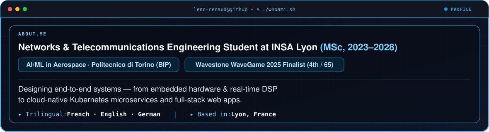

<code>leno-renaud@github ~ $ ./whoami.sh</code>

<picture>
  <source media="(prefers-color-scheme: light)" srcset="./assets/hero-intro-light.svg" />
  
</picture>

  <a href="https://www.linkedin.com/in/leno-renaud-4476a4342/"><strong>LinkedIn</strong></a> &nbsp;·&nbsp;
  <a href="mailto:leno.renaud@gmail.com"><strong>Email</strong></a> &nbsp;·&nbsp;
  <a href="#featured-projects"><strong>Featured Projects</strong></a>

<picture>
  <source media="(prefers-color-scheme: light)" srcset="https://www.gitskins.com/api/section/system-scan?username=leno-renaud&theme=neon&avatar=https%3A%2F%2Favatars.githubusercontent.com%2Fu%2F92721666%3Fv%3D4&style=terminal&v=oss-system-scan-2&mode=light" />
  
</picture>

## Engineering Pillars

<table width="100%">
<tr>
<td width="33%" valign="top">
<h3>Cloud-Native &amp; Backend</h3>

Distributed microservices orchestrated on <strong>K3s / Knative</strong> and <strong>Docker</strong>, paired with high-performance <strong>Fastify</strong>, <strong>Node.js</strong>, <strong>Flask</strong>, <strong>PostgreSQL</strong>, and real-time <strong>Socket.IO</strong> backends.

</td>
<td width="33%" valign="top">
<h3>Systems &amp; Networking</h3>

Concurrent &amp; multi-process engineering in <strong>Go</strong> and <strong>Python</strong> (IPC, TCP sockets, POSIX signals), plus multi-AS <strong>Cisco BGP / OSPF / RIP</strong> routing automation in <strong>GNS3</strong>.

</td>
<td width="33%" valign="top">
<h3>Full-Stack &amp; Embedded / IoT</h3>

End-to-end hardware-to-web systems: <strong>React 19</strong> &amp; <strong>Elm</strong> interfaces, real-time <strong>C++ / Teensy DSP (FAUST)</strong>, <strong>Web Serial / USB MIDI</strong>, <strong>Arduino</strong>, <strong>LoRaWAN / MQTT</strong>, and <strong>KiCad PCB</strong> design.

</td>
</tr>
</table>

## Technical Stack

<code>leno-renaud@github ~ $ ls skills/</code>

<picture>
  <source media="(prefers-color-scheme: light)" srcset="https://www.gitskins.com/api/section/stack?username=leno-renaud&theme=neon&avatar=https%3A%2F%2Favatars.githubusercontent.com%2Fu%2F92721666%3Fv%3D4&style=terminal&v=oss-stack-2&mode=light" />
  
</picture>

<table width="100%">
<tr>
<td width="24%"><strong>Languages</strong></td>
<td><code>JavaScript</code> · <code>Python</code> · <code>Go</code> · <code>C / C++</code> · <code>SQL</code> · <code>Elm</code> · <code>PHP</code> · <code>Bash</code> · <code>FAUST</code></td>
</tr>
<tr>
<td><strong>Web &amp; Real-Time</strong></td>
<td><code>React 19</code> · <code>Vite</code> · <code>Fastify</code> · <code>Express</code> · <code>Flask</code> · <code>Socket.IO</code> · <code>Leaflet</code> · <code>SCSS</code></td>
</tr>
<tr>
<td><strong>Cloud &amp; Data</strong></td>
<td><code>Kubernetes (K3s)</code> · <code>Knative</code> · <code>Docker</code> · <code>PostgreSQL</code> · <code>MySQL</code> · <code>REST APIs</code> · <code>Linux</code></td>
</tr>
<tr>
<td><strong>Networking</strong></td>
<td><code>BGP</code> · <code>OSPF</code> · <code>RIP</code> · <code>Cisco IOS</code> · <code>GNS3</code> · <code>TCP / IP</code> · <code>Network Automation</code></td>
</tr>
<tr>
<td><strong>Hardware &amp; Embedded</strong></td>
<td><code>Teensy (Audio DSP)</code> · <code>Arduino</code> · <code>LoRaWAN / MQTT</code> · <code>KiCad PCB</code> · <code>Web Serial</code> · <code>USB MIDI</code></td>
</tr>
</table>

## Featured Projects

<code>leno-renaud@github ~ $ ./projects.sh --featured</code>

<picture>
  <source media="(prefers-color-scheme: light)" srcset="https://www.gitskins.com/api/section/projects?username=leno-renaud&theme=neon&avatar=https%3A%2F%2Favatars.githubusercontent.com%2Fu%2F92721666%3Fv%3D4&repos=leno-renaud%2Fserverless-calculator-knative%2Cleno-renaud%2FGNS3-router-config-automation-RIP_OSPF_BGP%2Cleno-renaud%2Fsafe-travel-iot-transport-monitoring%2Cleno-renaud%2Fpolyphonic-synth-dsp&v=oss-projects-2&mode=light" />
  
</picture>

<table width="100%">
<tr>
<td width="50%" valign="top">
<h3><a href="https://github.com/Leno-Renaud/serverless-calculator-knative">serverless-calculator-knative</a></h3>

Cloud-Native Distributed Microservices · Feb–Apr 2026

Serverless distributed calculator deriving all arithmetic operations from a single <code>EML(a, b)</code> primitive across 4 microservices (React UI, Node.js/Express AST orchestrator, Python/Flask AST worker, Python EML core), autoscaled on <strong>K3s &amp; Knative</strong> with automated Bash deployment.

<code>K3s</code> · <code>Knative</code> · <code>Docker</code> · <code>Node.js</code> · <code>Python</code> · <code>React</code>

</td>
<td width="50%" valign="top">
<h3><a href="https://github.com/Leno-Renaud/GNS3-router-config-automation-RIP_OSPF_BGP">GNS3-router-config-automation-RIP_OSPF_BGP</a></h3>

Multi-AS Network Automation · Nov 2025–Feb 2026

Network automation workflow that parses multi-AS GNS3 topologies, generates mixed routing configurations (<strong>RIP</strong>, <strong>OSPF</strong>, <strong>BGP</strong>, and Gao-Rexford community policies), and automatically injects startup-configs into Cisco c7200 routers through a <strong>Tkinter</strong> GUI.

<code>Python</code> · <code>GNS3</code> · <code>Cisco IOS</code> · <code>BGP</code> · <code>OSPF</code> · <code>RIP</code>

</td>
</tr>
<tr>
<td width="50%" valign="top">
<h3><a href="https://github.com/Leno-Renaud/safe-travel-iot-transport-monitoring">safe-travel-iot-transport-monitoring</a></h3>

End-to-End IoT Telemetry &amp; ML · Mar–Jun 2025

Complete hardware-to-web system monitoring ride comfort and safety in public transport: custom <strong>KiCad PCB</strong> &amp; <strong>Arduino</strong> sensors, <strong>LoRaWAN / MQTT (TTN)</strong> ingestion into <strong>MySQL</strong>, <strong>Python</strong> decision-tree analysis, and a <strong>PHP / JS</strong> monitoring dashboard.

<code>Arduino / C++</code> · <code>KiCad</code> · <code>LoRaWAN / MQTT</code> · <code>Python ML</code> · <code>MySQL</code> · <code>PHP / JS</code>

</td>
<td width="50%" valign="top">
<h3><a href="https://github.com/Leno-Renaud/polyphonic-synth-dsp">polyphonic-synth-dsp</a></h3>

Real-Time Embedded Audio DSP · Dec 2025–Feb 2026

4-voice real-time polyphonic synthesizer running on <strong>Teensy + Audio Shield (SGTL5000)</strong> powered by a <strong>FAUST</strong> DSP engine (10 presets), with <strong>USB MIDI</strong> performance input and a live browser <strong>Web Serial</strong> controller for ADSR, filters, and vibrato.

<code>Embedded C++</code> · <code>Teensy</code> · <code>FAUST DSP</code> · <code>Web Serial</code> · <code>USB MIDI</code>

</td>
</tr>
</table>

### More Engineering Projects

<table width="100%">
<tr>
<td width="34%" valign="top"><strong><a href="https://github.com/Leno-Renaud/social-network-react-fastify">social-network-react-fastify</a></strong> Apr–Jun 2026</td>
<td valign="top">Full-stack student social &amp; travel-matching platform with JWT/bcrypt authentication, interactive <strong>Leaflet</strong> event discovery, companion matching, and real-time <strong>Socket.IO</strong> chat. <code>React 19</code> · <code>Vite</code> · <code>Fastify</code> · <code>PostgreSQL</code> · <code>Socket.IO</code> · <code>SCSS</code></td>
</tr>
<tr>
<td valign="top"><strong><a href="https://github.com/Leno-Renaud/python-multiprocessing-circle-of-life">python-multiprocessing-circle-of-life</a></strong> Nov 2025–Feb 2026</td>
<td valign="top">Multi-process OS predator–prey simulation where each entity runs as an independent process combining <code>BaseManager</code> shared state, a <strong>TCP</strong> action server, <strong>POSIX signals</strong>, and a live CLI dashboard (zero third-party dependencies). <code>Python</code> · <code>Multiprocessing</code> · <code>IPC</code> · <code>TCP Sockets</code> · <code>POSIX Signals</code></td>
</tr>
<tr>
<td valign="top"><strong><a href="https://github.com/Leno-Renaud/software-engineering-js-elm-go">software-engineering-js-elm-go</a></strong> Nov 2025–Feb 2026</td>
<td valign="top">Multi-paradigm software engineering portfolio: sequential vs. parallel image processing + TCP client/server in <strong>Go</strong>, functional MVU Wordle in <strong>Elm</strong>, and OOP Flip 7 terminal card game in modern <strong>JavaScript</strong>. <code>Go</code> · <code>Elm</code> · <code>JavaScript</code> · <code>Concurrency</code> · <code>TCP</code></td>
</tr>
</table>

## Contribution Activity

<picture>
  <source media="(prefers-color-scheme: light)" srcset="https://www.gitskins.com/api/section/heatmap?username=leno-renaud&theme=neon&avatar=https%3A%2F%2Favatars.githubusercontent.com%2Fu%2F92721666%3Fv%3D4&v=oss-heatmap-2&mode=light" />
  
</picture>

<code>leno-renaud@github ~ $ neofetch</code> (live GitHub snapshot)

 

<picture>
  <source media="(prefers-color-scheme: light)" srcset="https://www.gitskins.com/api/section/stats?username=leno-renaud&theme=neon&avatar=https%3A%2F%2Favatars.githubusercontent.com%2Fu%2F92721666%3Fv%3D4&style=terminal&v=oss-stats-2&mode=light" />
  
</picture>

## Get in Touch

<code>leno-renaud@github ~ $ contact --connect</code>

Open to discussing software engineering, cloud &amp; network infrastructure, full-stack development, and embedded/IoT opportunities.

<picture>
  <source media="(prefers-color-scheme: light)" srcset="https://www.gitskins.com/api/section/social?username=leno-renaud&theme=neon&avatar=https%3A%2F%2Favatars.githubusercontent.com%2Fu%2F92721666%3Fv%3D4&linkedin=leno-renaud-4476a4342&email=leno.renaud%40gmail.com&v=oss-social-2&mode=light" />
  
</picture>

  <a href="https://www.linkedin.com/in/leno-renaud-4476a4342/">LinkedIn</a> &nbsp;·&nbsp;
  <a href="mailto:leno.renaud@gmail.com">leno.renaud@gmail.com</a> &nbsp;·&nbsp;
  <a href="https://github.com/Leno-Renaud">GitHub</a>

